<!-- QUICK NAV -->
<nav class="aurora-toc" aria-label="Quick navigation">
  <a href="#overview">Overview</a>
  <a href="#highlights">Highlights</a>
  <a href="#dashboards">Dashboards</a>
  <a href="#tech">Tech</a>
  <a href="#governance">Governance</a>
  <a href="#outcomes">Outcomes</a>
  <a href="#assets">Assets</a>
  <a href="#gallery">Gallery</a>
</nav>

<h3 id="overview">Overview</h3>
A Northern Ireland–specific, NHSCT-aligned transformation project. I designed and built **Aurora Domiciliary Care**, a full analytics ecosystem showcasing best practice in **operations, workforce, finance, and compliance**.  
It features realistic **runs & rotas**, **ECM data** (GPS, travel, shift types), **finance uplift rules**, and **NHSCT locality models**, all with **GDPR-by-design** principles and role-based security.

---

### 🔍 Key Highlights
- **Runs & Rotas:** AM/PM/Night visits, primary/secondary carers, ordered sequences, travel-time mapping.  
- **ECM Realism:** GPS validation, travel minutes, weekend/evening/night uplifts, visit verification.  
- **Finance Automation:** Claimed vs Paid variance tracking, evening (+5%), night (+10%), weekend (+10%) uplifts, and remittance reconciliation.  
- **Compliance & Quality:** RQIA inspections with timeline and outcome scores, incident tracking, complaints SLA, and training expiry analytics.  
- **Locality Benchmarking:** Antrim/Ballymena, Causeway, Mid Ulster, and East Antrim KPI comparisons.

---

## 🖥️ Dashboards

<!-- Dashboards Tabs -->
<nav class="aurora-toc" aria-label="Report formats">
<a href="#dash-powerbi">Power BI</a>
<a href="#dash-excel">Excel</a>
<a href="#dash-access">Access (TBC)</a>
</nav>

  <!-- Dashboards: POWER BI -->
  

    <h3>Power BI</h3>
    

      <figure class="aurora-item">
        <a href="/img/portfolio/aurora/aurora_dashboard_kpi_pbi.png">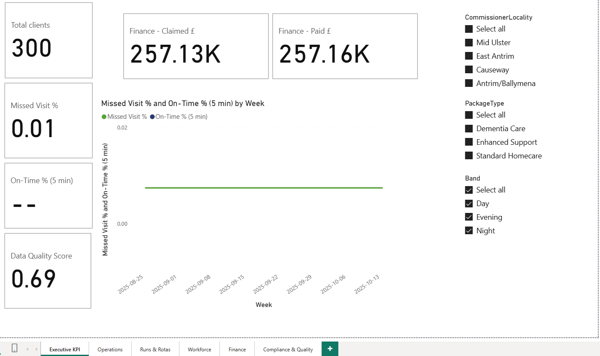</a>
        <figcaption>Executive KPI Dashboard</figcaption>
      </figure>
      <figure class="aurora-item">
        <a href="/img/portfolio/aurora/aurora_dashboard_ops_pbi.png">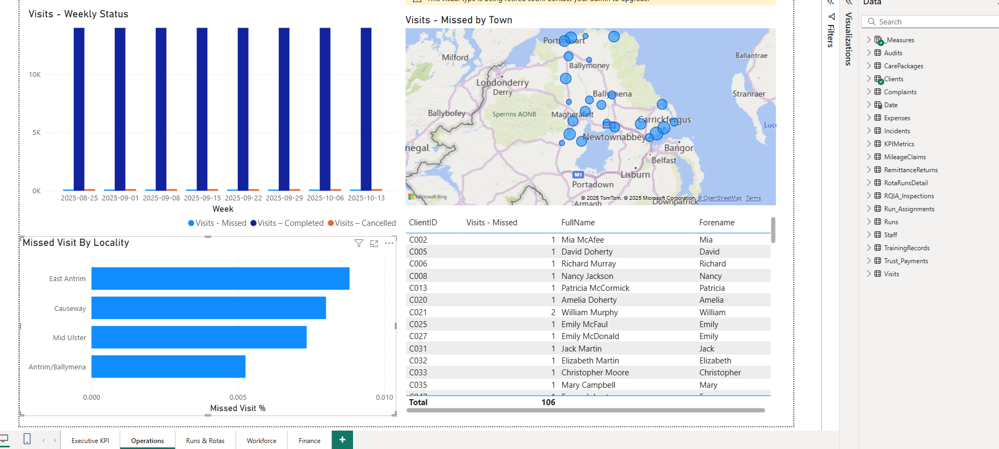</a>
        <figcaption>Operations Performance Overview</figcaption>
      </figure>
      <figure class="aurora-item">
        <a href="/img/portfolio/aurora/aurora_dashboard_finance_pbi.png">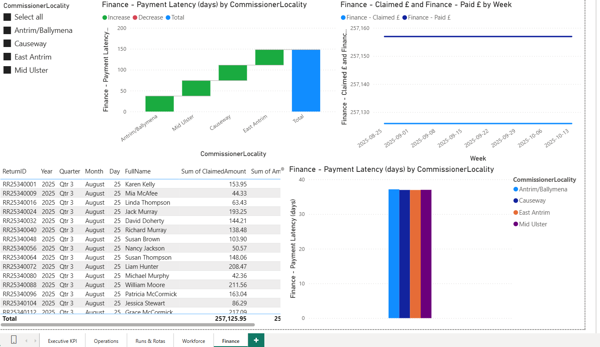</a>
        <figcaption>Finance Claimed vs Paid</figcaption>
      </figure>
      <figure class="aurora-item">
        <a href="/img/portfolio/aurora/aurora_dashboard_qa_pbi.png">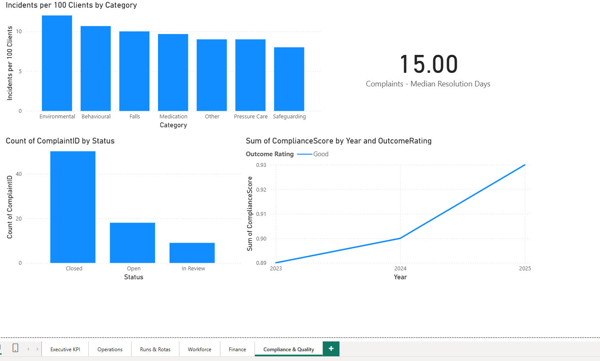</a>
        <figcaption>Compliance & Quality</figcaption>
      </figure>
      <figure class="aurora-item">
        <a href="/img/portfolio/aurora/aurora_dashboard_rr_pbi.png">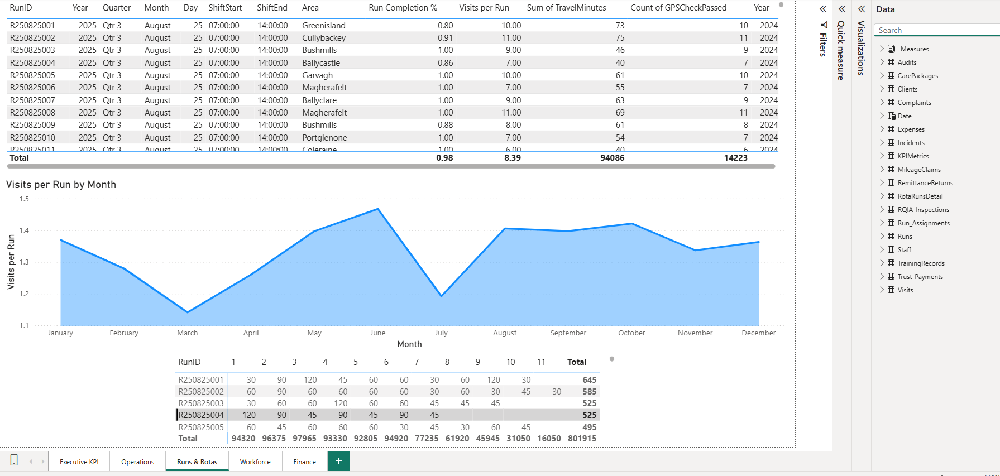</a>
        <figcaption>Runs & Rotas (Overview)</figcaption>
      </figure>
      <figure class="aurora-item">
        <a href="/img/portfolio/aurora/aurora_dashboard_wf_pbi.png">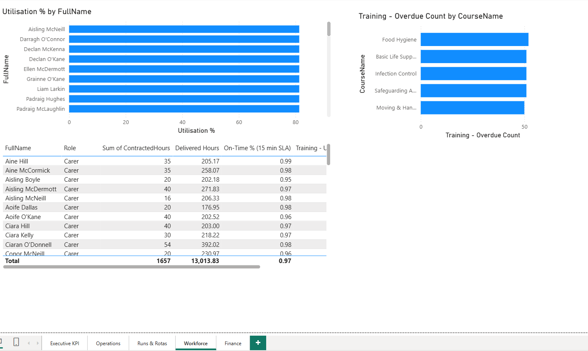</a>
        <figcaption>Workforce KPIs</figcaption>
      </figure>
    

  

  <!-- Dashboards: EXCEL -->
  

    <h3>Excel</h3>
    

      <figure class="aurora-item">
        <a href="/img/portfolio/aurora/aurora_kpi_excel.png">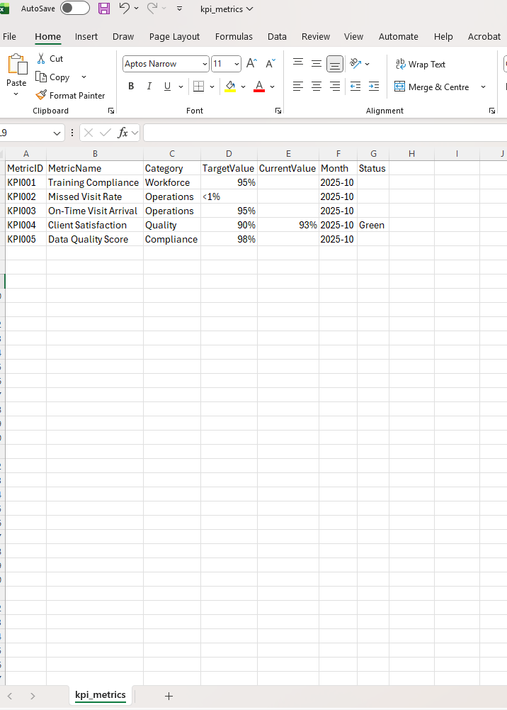</a>
        <figcaption>Excel – KPI Overview</figcaption>
      </figure>
      <figure class="aurora-item">
        <a href="/img/portfolio/aurora/aurora_carepackages_excel.png">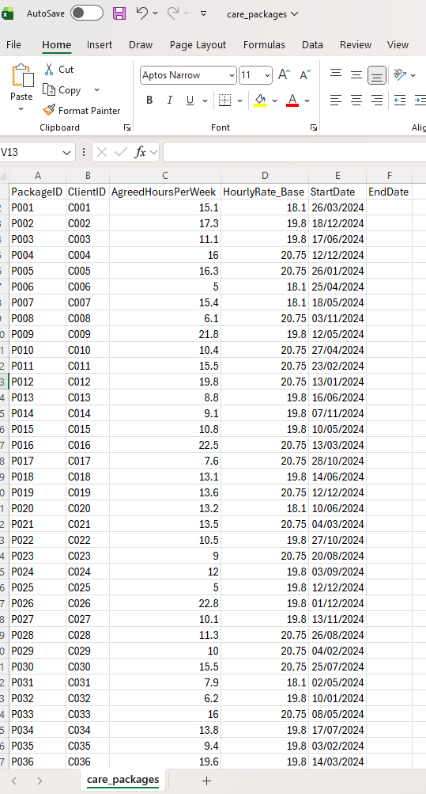</a>
        <figcaption>Excel – Care Packages</figcaption>
      </figure>
      <figure class="aurora-item">
        <a href="/img/portfolio/aurora/aurora_clients_excel.png">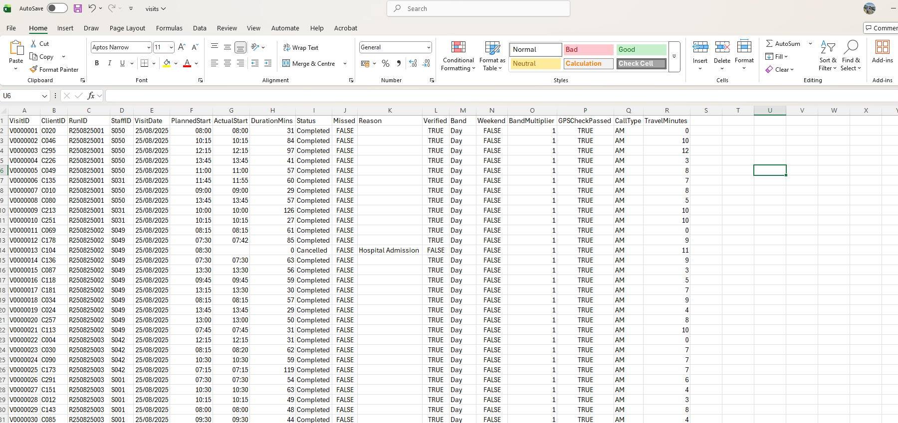</a>
        <figcaption>Excel – Clients</figcaption>
      </figure>
      <figure class="aurora-item">
        <a href="/img/portfolio/aurora/aurora_rr_excel.png">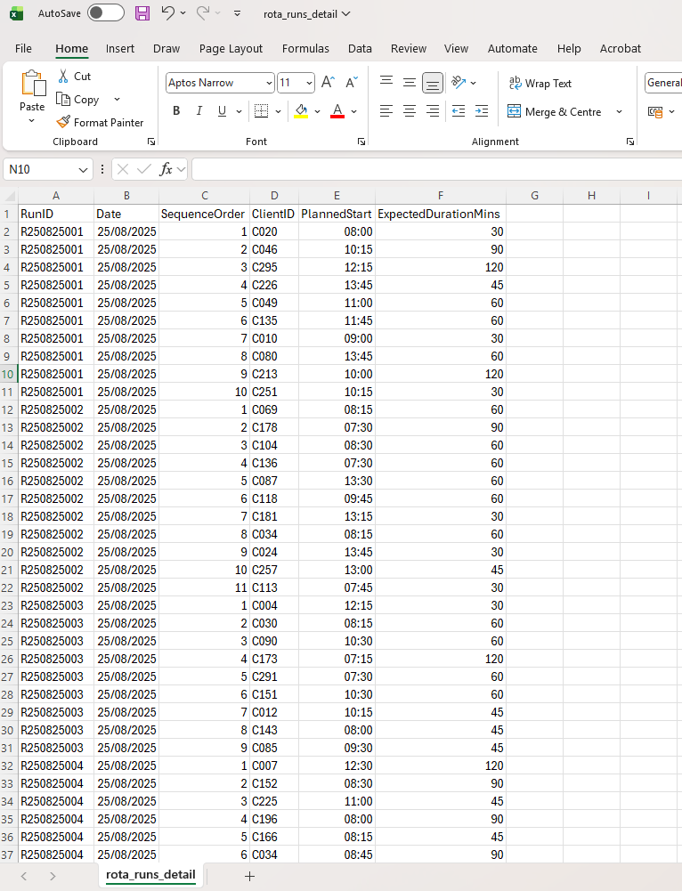</a>
        <figcaption>Excel – Runs & Rotas</figcaption>
      </figure>
      <figure class="aurora-item">
        <a href="/img/portfolio/aurora/aurora_remittance_excel.png">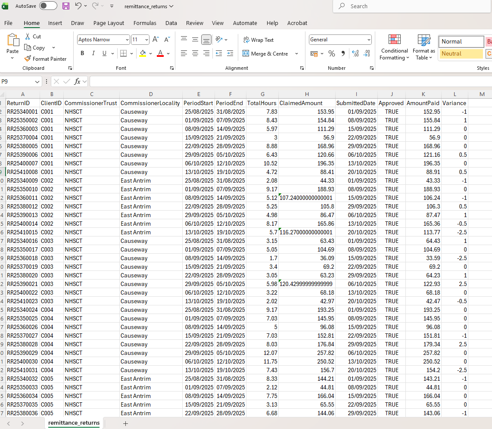</a>
        <figcaption>Excel – Remittance</figcaption>
      </figure>
      <figure class="aurora-item">
        <a href="/img/portfolio/aurora/aurora_trustpayments_excel.png">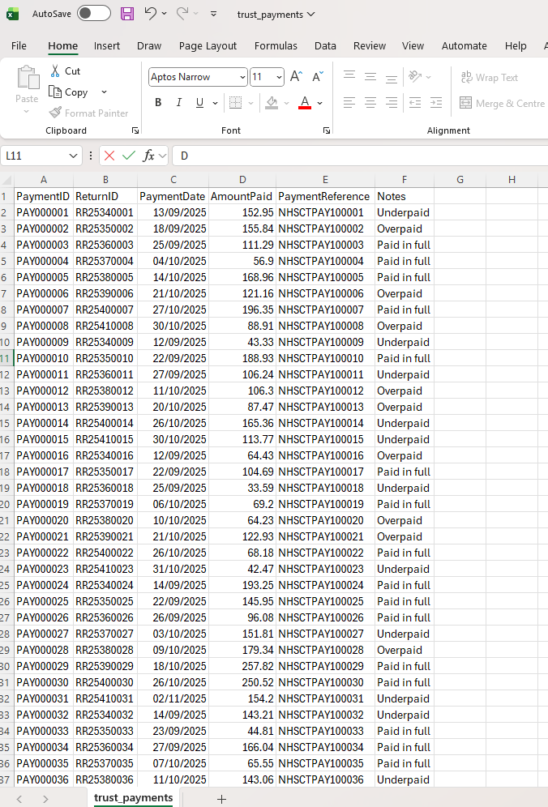</a>
        <figcaption>Excel – Trust Payments</figcaption>
      </figure>
    

  

  <!-- Dashboards: ACCESS -->
  

    <h3>Access</h3>
    

      
Access Data Model (TBC)

      
Planned: schema diagram, table validation, audit trail examples.

    

  

---

### ⚙️ Tech Stack
| Layer | Technology |
|:--|:--|
| **Data Layer** | Microsoft Access / SQL – validated tables with audit fields |
| **ETL / Prep** | Power Query, scheduled refresh, DAX measures |
| **Analytics** | Power BI (RLS, field parameters, drillthrough, decomposition tree) |
| **Ops Toolkit** | Excel-based Analyst Toolkit (pivots, slicers, validation charts) |

---

### 🔐 Governance & Security
- **UK GDPR / DPA 2018:** Fully synthetic dataset; privacy-by-design model.  
- **Access Control:** Power BI RLS roles — `Manager_By_Locality`, `Staff_Self`.  
- **Data Quality:** Verified %, On-Time SLA %, Missed Visit %, Training Compliance %.  
- **Audit & Retention:** Full traceability for incidents, complaints, audits, and RQIA outcomes with purge policy demo.

---

### 📊 Outcomes
- **Operational Insight:** Missed visits <1%, punctuality and travel-time performance measured.  
- **Financial Transparency:** End-to-end claimed/paid reconciliation and locality variance clarity.  
- **Compliance Readiness:** Real-time inspection and training readiness dashboards; full audit traceability.  
- **Transformational Model:** Demonstrates NI-specific digital transformation aligned with NHSCT locality structure.

---

### 🧩 Assets
- `Aurora.accdb` — Access data model (clients, staff, runs, finance, compliance)  
- `Aurora_PowerBI.pbix` — Executive dashboards  
- `Aurora_Analyst_Toolkit.xlsx` — Excel insights pack  
- `/img/portfolio/aurora/` — Screenshot gallery

---

## 🗂️ Gallery

<!-- Gallery Tabs -->
<nav class="aurora-toc" aria-label="Report formats">
<a href="#tab-powerbi">Power BI</a>
<a href="#tab-excel">Excel</a>
<a href="#tab-access">Access (TBC)</a>
</nav>

  <!-- GALLERY: POWER BI (full set including mobile + DAX + modeling) -->
  

    <h3>Power BI</h3>
    

      <figure class="aurora-item" role="listitem"><figcaption>Executive KPI Dashboard</figcaption></figure>
      <figure class="aurora-item" role="listitem"><a href="/img/portfolio/aurora/aurora_dashboard_kpi__mobile_pbi.png">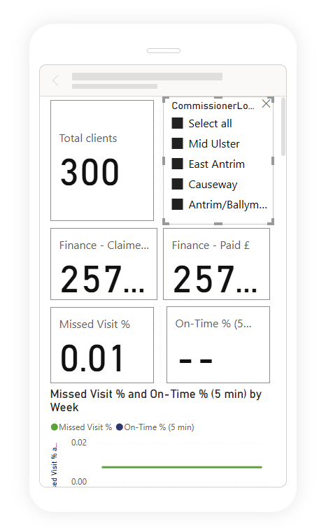</a><figcaption>KPI (Mobile)</figcaption></figure>

      <figure class="aurora-item" role="listitem"><figcaption>Operations Overview</figcaption></figure>
      <figure class="aurora-item aurora-item--wide" role="listitem"><a href="/img/portfolio/aurora/aurora_dashboard_ops_ws.png">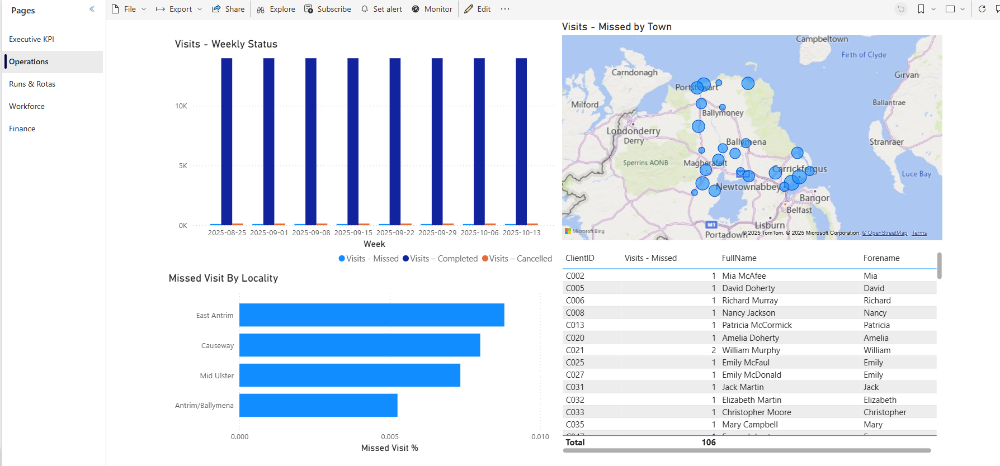</a><figcaption>Operations (Wide)</figcaption></figure>

      <figure class="aurora-item" role="listitem"><figcaption>Finance – Claimed vs Paid</figcaption></figure>
      <figure class="aurora-item" role="listitem"><a href="/img/portfolio/aurora/aurora_dashboard_finance_mobile_pbi.png">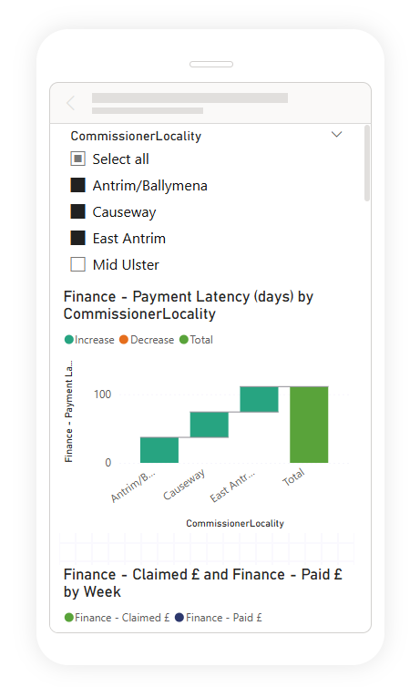</a><figcaption>Finance (Mobile)</figcaption></figure>

      <figure class="aurora-item" role="listitem"><figcaption>Quality & Compliance</figcaption></figure>
      <figure class="aurora-item" role="listitem"><a href="/img/portfolio/aurora/aurora_dashboard_qa_mobile_pbi.png">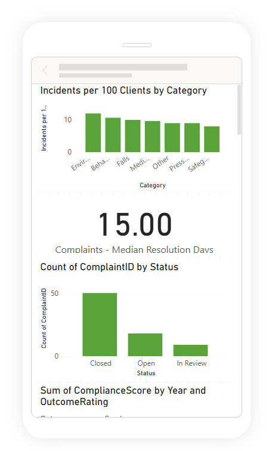</a><figcaption>Compliance (Mobile)</figcaption></figure>

      <figure class="aurora-item" role="listitem"><figcaption>Runs & Rotas</figcaption></figure>
      <figure class="aurora-item" role="listitem"><a href="/img/portfolio/aurora/aurora_dashboard_rr_mobile_pbi.png">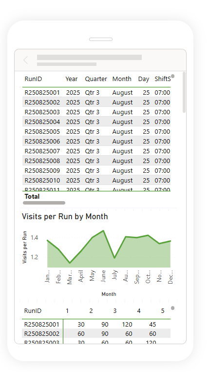</a><figcaption>Runs & Rotas (Mobile)</figcaption></figure>

      <figure class="aurora-item" role="listitem"><figcaption>Workforce KPIs</figcaption></figure>
      <figure class="aurora-item" role="listitem"><a href="/img/portfolio/aurora/aurora_dashboard_wf_mobile_pbi.png">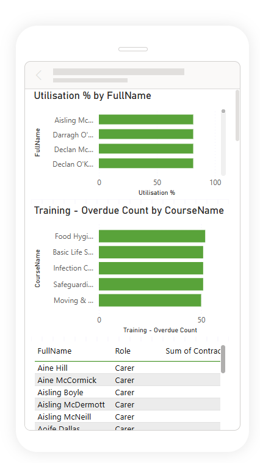</a><figcaption>Workforce (Mobile)</figcaption></figure>

      <figure class="aurora-item" role="listitem"><a href="/img/portfolio/aurora/aurora_clients_pq_pbi.png">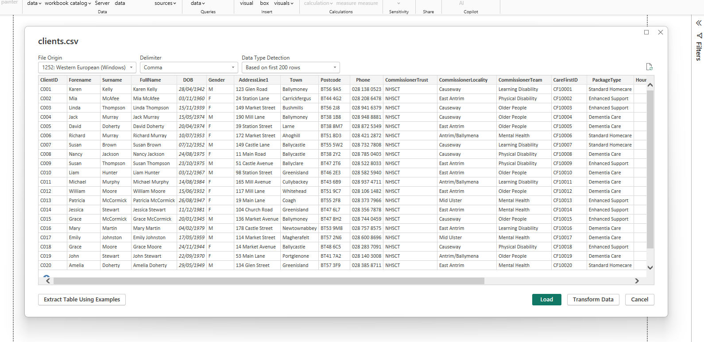</a><figcaption>Power Query – Clients</figcaption></figure>
      <figure class="aurora-item" role="listitem"><a href="/img/portfolio/aurora/aurora_training_records_pq_pbi.png">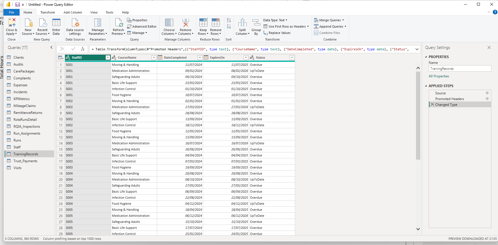</a><figcaption>Power Query – Training Records</figcaption></figure>

      <figure class="aurora-item" role="listitem"><a href="/img/portfolio/aurora/aurora_tables_pbi.png">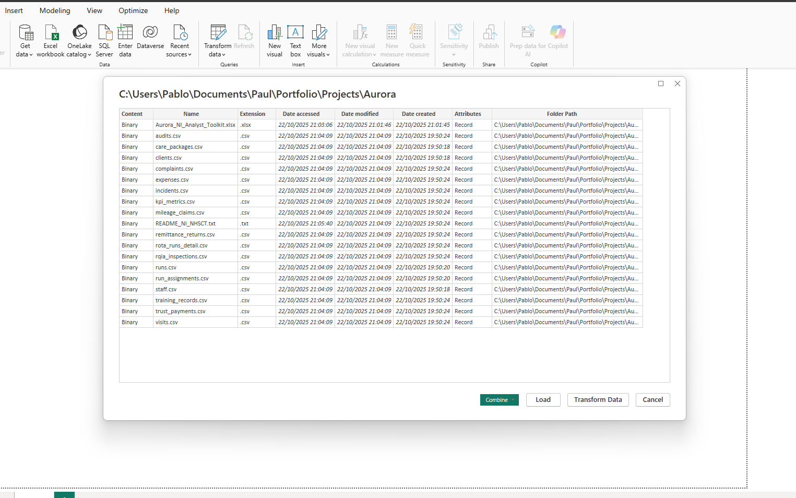</a><figcaption>Tables View</figcaption></figure>
      <figure class="aurora-item" role="listitem"><a href="/img/portfolio/aurora/aurora_relationship_pbi.png">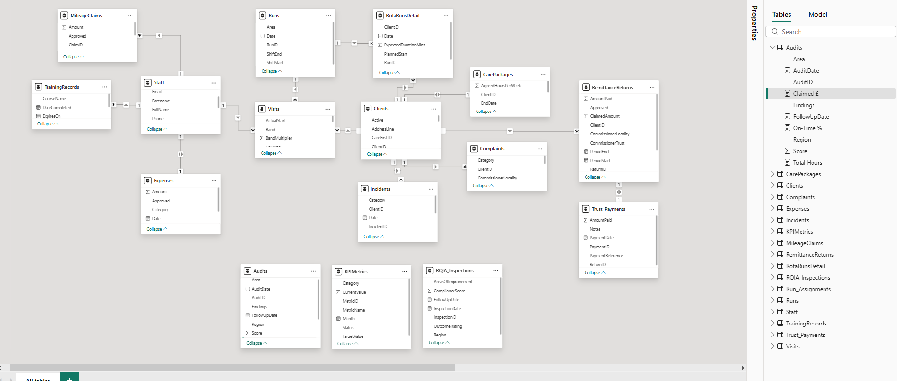</a><figcaption>Relationship Model</figcaption></figure>

      <figure class="aurora-item" role="listitem"><a href="/img/portfolio/aurora/aurora_measure_example_1.png">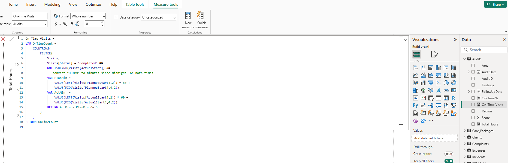</a><figcaption>DAX Measure – 1</figcaption></figure>
      <figure class="aurora-item" role="listitem"><a href="/img/portfolio/aurora/aurora_measure_example_2.png">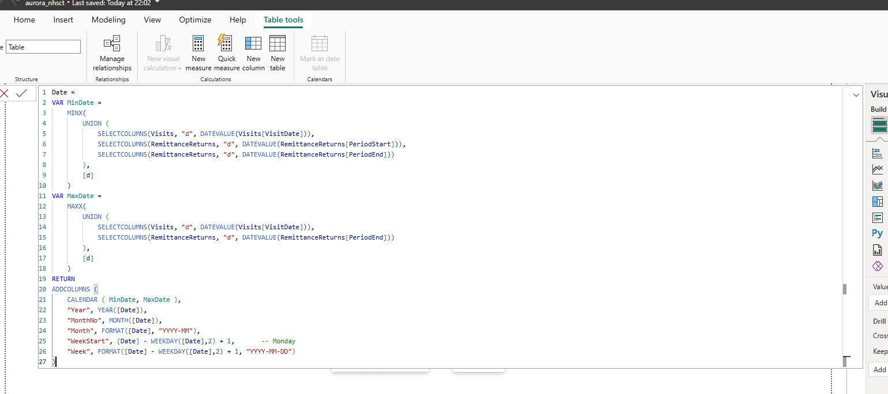</a><figcaption>DAX Measure – 2</figcaption></figure>
      <figure class="aurora-item" role="listitem"><a href="/img/portfolio/aurora/aurora_measure_example_3.png">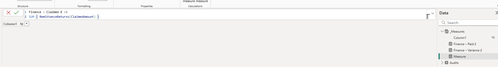</a><figcaption>DAX Measure – 3</figcaption></figure>
      <figure class="aurora-item" role="listitem"><a href="/img/portfolio/aurora/aurora_measure_example_4.png">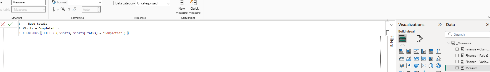</a><figcaption>DAX Measure – 4</figcaption></figure>
      <figure class="aurora-item" role="listitem"><a href="/img/portfolio/aurora/aurora_measure_example_5.png">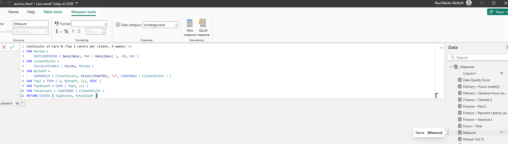</a><figcaption>DAX Measure – 5</figcaption></figure>

      <figure class="aurora-item" role="listitem"><a href="/img/portfolio/aurora/aurora_measures_dash.png">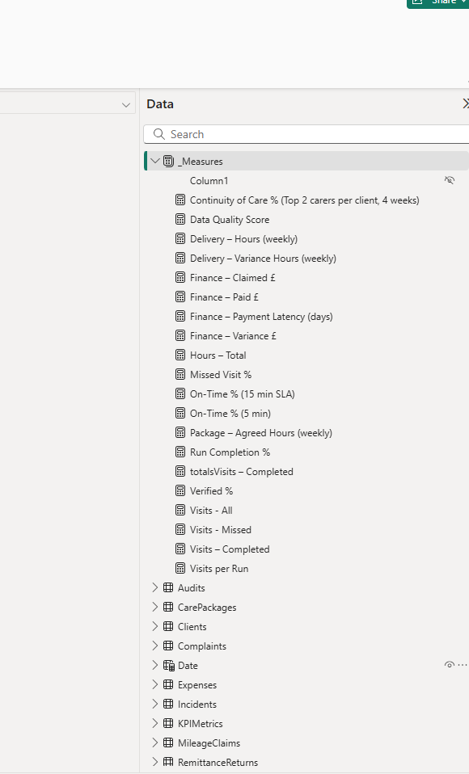</a><figcaption>Measures Dashboard</figcaption></figure>
      <figure class="aurora-item" role="listitem"><a href="/img/portfolio/aurora/aurora_pq_editor.png">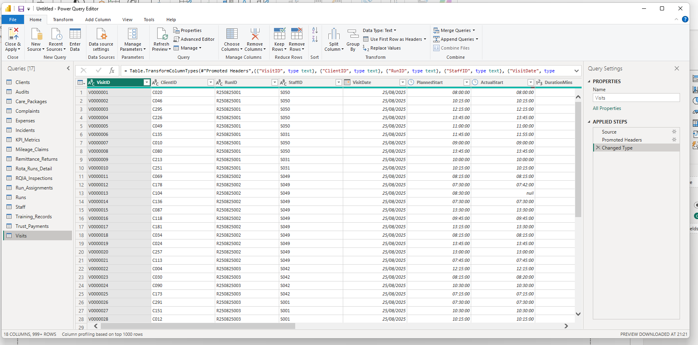</a><figcaption>Power Query Editor</figcaption></figure>
    

  

  <!-- GALLERY: EXCEL (all Excel assets) -->
  

    <h3>Excel</h3>
    

      <figure class="aurora-item" role="listitem"><figcaption>Excel – KPI Overview</figcaption></figure>
      <figure class="aurora-item" role="listitem"><figcaption>Excel – Care Packages</figcaption></figure>
      <figure class="aurora-item" role="listitem"><figcaption>Excel – Clients</figcaption></figure>
      <figure class="aurora-item" role="listitem"><figcaption>Excel – Runs & Rotas</figcaption></figure>
      <figure class="aurora-item" role="listitem"><figcaption>Excel – Remittance</figcaption></figure>
      <figure class="aurora-item" role="listitem"><figcaption>Excel – Trust Payments</figcaption></figure>
      <figure class="aurora-item" role="listitem"><a href="/img/portfolio/aurora/aurora_expenses_excel.png">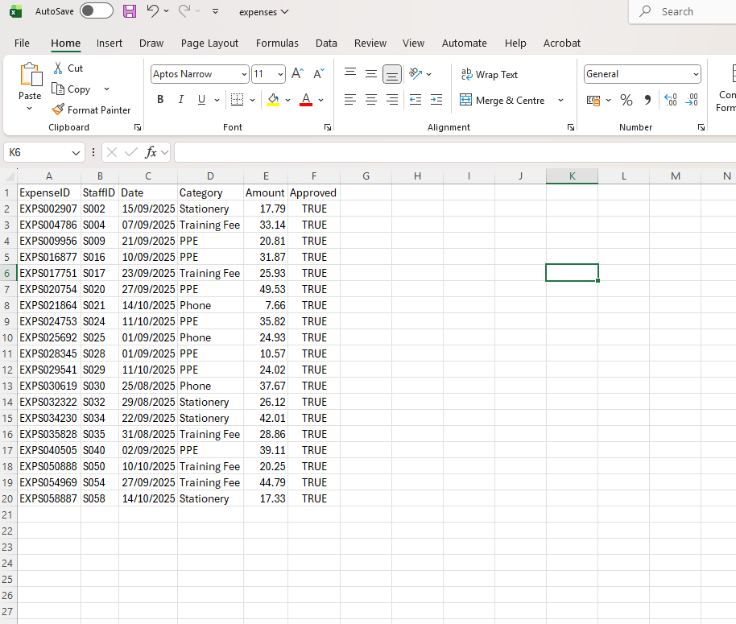</a><figcaption>Excel – Expenses</figcaption></figure>
      <figure class="aurora-item" role="listitem"><a href="/img/portfolio/aurora/aurora_mileage_excel.png">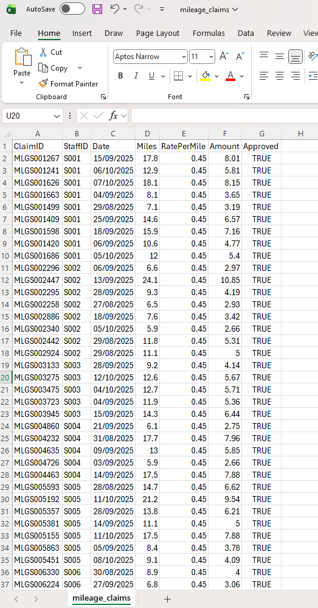</a><figcaption>Excel – Mileage</figcaption></figure>
      <figure class="aurora-item" role="listitem"><a href="/img/portfolio/aurora/aurora_staff_excel.png">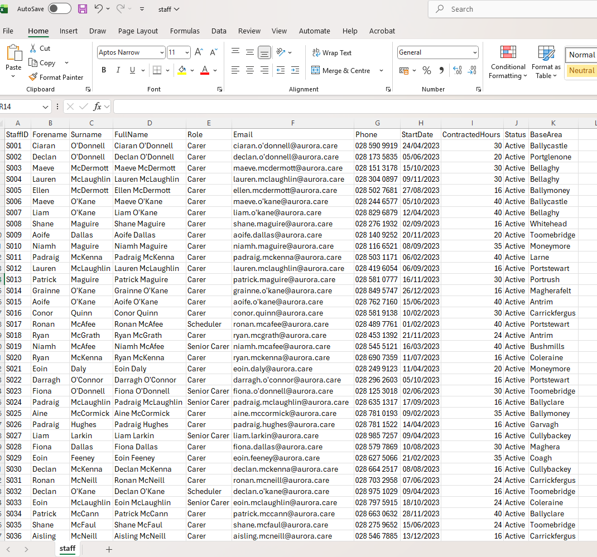</a><figcaption>Excel – Staff</figcaption></figure>
      <figure class="aurora-item" role="listitem"><a href="/img/portfolio/aurora/aurora_complaints_excel.png">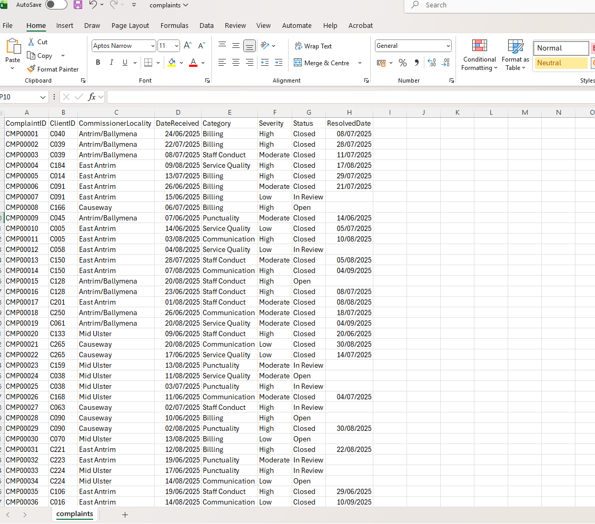</a><figcaption>Excel – Complaints</figcaption></figure>
    

  

  <!-- GALLERY: ACCESS -->
  

    <h3>Access</h3>
    

      
Access Data Model (TBC)

      
Future: schema diagram, table validation, audit trail examples.

    

  

